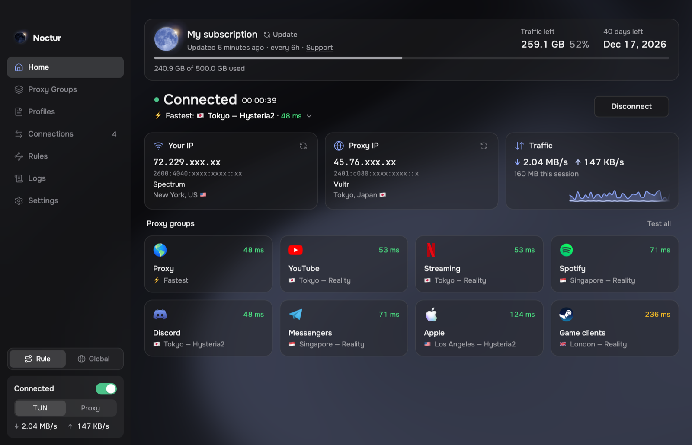
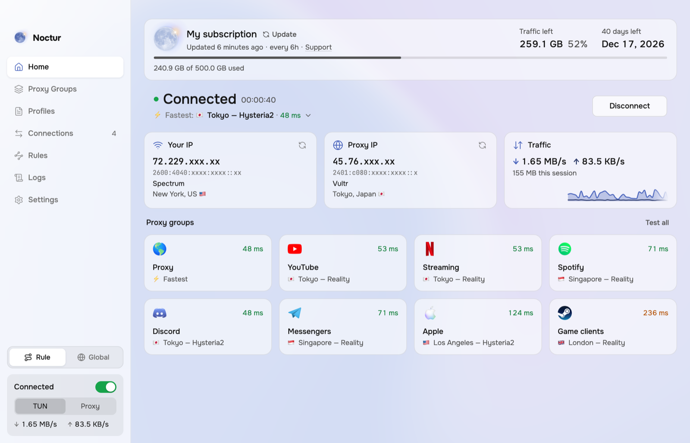
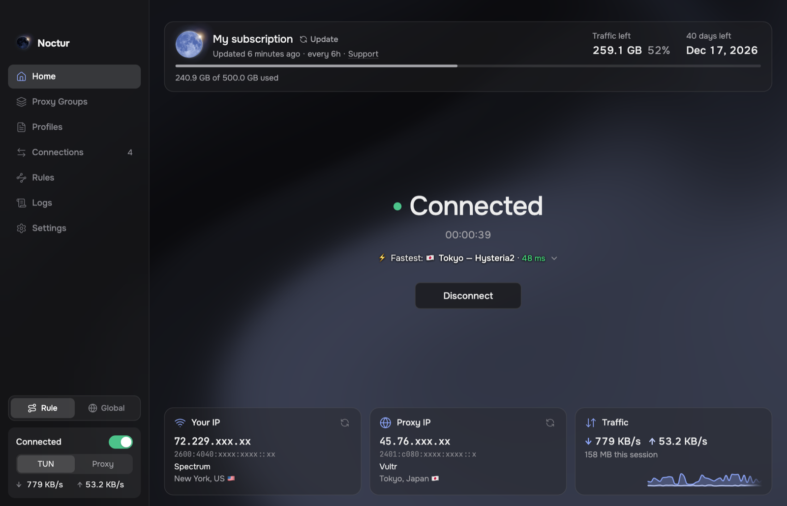
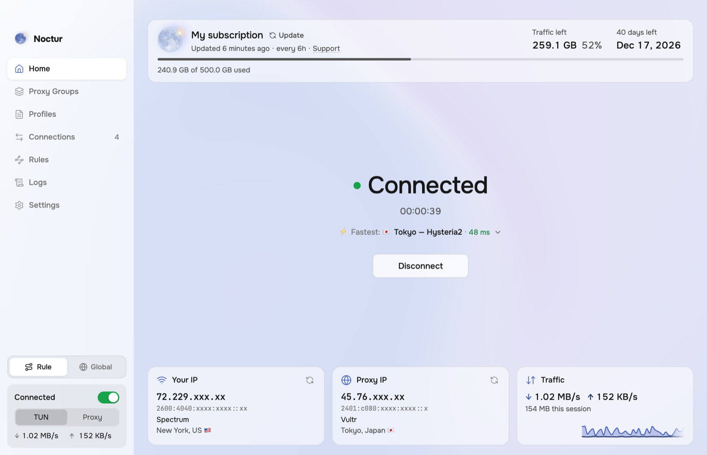
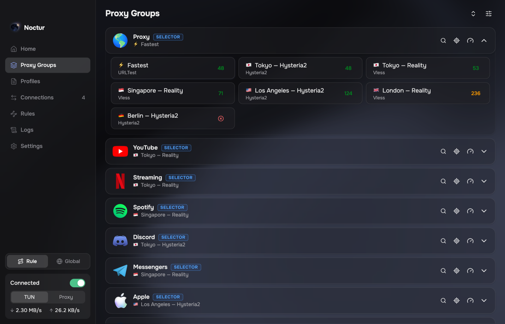
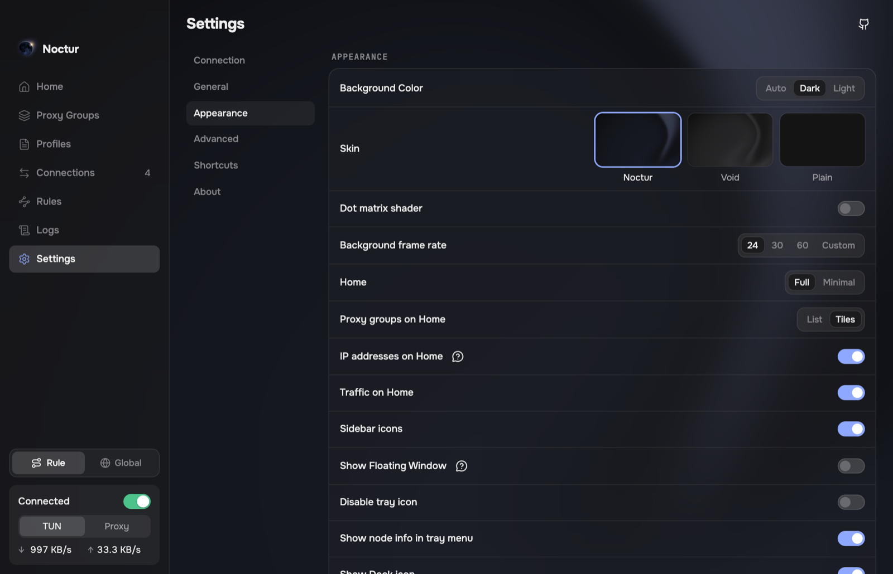

<p align="center">
  
</p>

<h1 align="center">Noctur</h1>

<p align="center">A modern client for the <a href="https://github.com/MetaCubeX/mihomo">mihomo</a> core with the full feature set, for macOS, Windows and Linux</p>

<p align="center">
  <a href="https://github.com/Derpcrawler/noctur/releases/latest"></a>
  <a href="./LICENSE"></a>
</p>

<p align="center"></p>

## Features

- Beautiful design with light and dark modes, plus plenty of customization
- Home at a glance: connection, traffic and IP addresses
- TUN mode and system proxy
- Subscription usage and expiry (Remnawave and similar panels)
- Proxy groups with latency tests, rules, connections and logs
- TUN, DNS and sniffer settings
- Profile editor with validation
- Profile import from `clash://` links
- mihomo core updates from Settings, independent of app updates
- In-app updates on macOS and Windows
- Lightweight mode that frees memory while the window is closed
- English, Russian, Chinese

## Download

Get the latest version from [Releases](https://github.com/Derpcrawler/noctur/releases/latest).

| System | File |
|---|---|
| macOS 13 or later, Apple Silicon | `Noctur_<version>_arm64.pkg` |
| Windows 10 or 11, x64 | `Noctur_<version>_x64-setup.exe` |
| Debian, Ubuntu and derivatives, x64 | `Noctur_<version>_amd64.deb` |
| Fedora, openSUSE, x64 | `Noctur_<version>_x86_64.rpm` |
| Arch and derivatives, x64 | `Noctur_<version>_x64.pkg.tar.xz` |

### First launch

The builds are not signed with an Apple or Microsoft certificate, so macOS and Windows ask for confirmation once:

- **macOS:** open System Settings, Privacy & Security, click Open Anyway next to the message about the installer, and run it again.
- **Windows:** in the "Windows protected your PC" message, click More info, then Run anyway.
- **Linux:** install the package with your package manager, for example `sudo apt install ./Noctur_<version>_amd64.deb`.

Coming from Astra Clash? Install Noctur over it: your settings, profiles and autostart move over on first start.

Found a bug? [Open an issue](https://github.com/Derpcrawler/noctur/issues).

## Build from source

You need Node.js 22.12 or later, pnpm 10 and Git. Building for Windows also needs Go 1.21 or later, and building on macOS needs the Xcode Command Line Tools.

```bash
git clone https://github.com/Derpcrawler/noctur.git
cd noctur
pnpm install   # also downloads mihomo, geo data and helpers for this system
pnpm dev
```

Packages, built on the system you are packaging for:

```bash
pnpm build:mac --arm64      # .pkg
pnpm build:win --x64        # .exe installer
pnpm build:linux --x64      # .deb, .rpm and .pkg.tar.xz
pnpm build:linux deb --x64  # one format only: deb, rpm or pacman
```

Packages land in `dist/`.

| Command | What it does |
|---|---|
| `pnpm dev` | Start the app with hot reload for the interface (restart for main process changes) |
| `pnpm test` | Run the tests |
| `pnpm typecheck` | Check types |
| `pnpm lint` | Run ESLint |

<details>
<summary>Building for another system</summary>

`pnpm install` downloads the core and helpers for the system you're on. To package for another one, fetch its binaries first; this replaces the current ones, so run it again for your own system afterwards.

```bash
node scripts/prepare.mjs --x64 --win     # then pnpm build:win --x64
node scripts/prepare.mjs --x64 --linux   # then pnpm build:linux --x64
node scripts/prepare.mjs --arm64 --mac   # back to macOS binaries
```

Linux packages built on macOS need `rpmbuild` (`brew install rpm`) and GNU `ar` first on your PATH (`brew install binutils`, then add `$(brew --prefix binutils)/bin`). With the macOS `ar`, the .deb comes out empty.

</details>

## Screenshots

| | |
|---|---|
|  |  |
|  |  |
|  |  |

## Credits

Based on [Koala Clash](https://github.com/coolcoala/koala-clash) by coolcoala, which builds on [Sparkle](https://github.com/xishang0128/sparkle) and [Mihomo Party](https://github.com/mihomo-party-org/mihomo-party). The proxy core is [mihomo](https://github.com/MetaCubeX/mihomo).

## License

GPL-3.0. See [LICENSE](./LICENSE).
